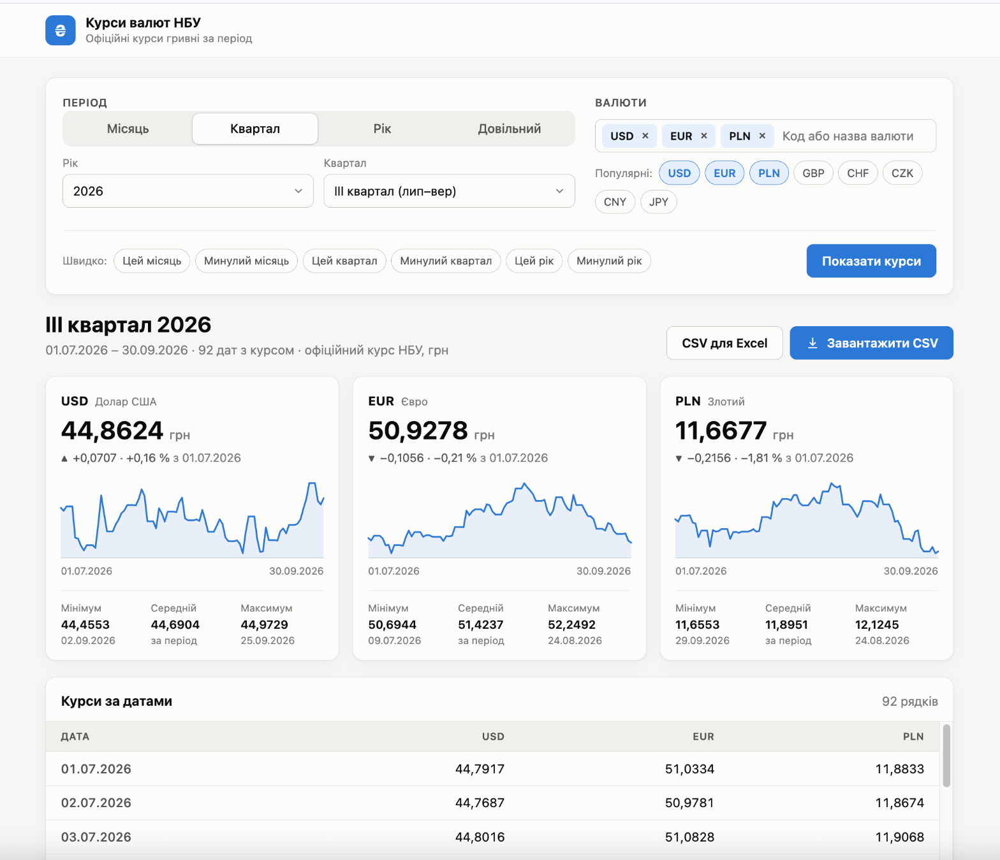

# Генератор курсів валют НБУ за період з веб-інтерфейсом

[](https://github.com/EnjoyFX/uarates_web/actions/workflows/tests.yml)
[](https://github.com/EnjoyFX/uarates_web/actions/workflows/tests.yml)

Цей проект є генератором csv-файлів, що використовує відкритий API Національного банку України для отримання актуальних курсів.



## Функціонал

- **Вибір періоду:** місяць, квартал, рік або довільні дати; швидкі кнопки «Минулий місяць», «Цей квартал» тощо.
- **Вибір валют:** пошук за кодом або назвою з довідника НБУ, популярні валюти в один клік.
- **Аналітика:** для кожної валюти — курс на кінець періоду, зміна, мінімум, максимум, середній і графік динаміки.
- **Підключення до API:** Використовується відкритий API Національного банку України для отримання валютних даних.
- **Експорт:** звичайний CSV (кома) та «CSV для Excel» (`;`, десяткова кома, UTF-8 BOM).
- Результати мають постійне посилання — його можна зберегти або надіслати колезі.

## Використання

1. **Збірка докер-образу:**
```bash
docker build -t ua-rates2 .
```
2. **Запуск контейнера:**
```bash
docker run -p 5555:5555 ua-rates2
```
3. **У браузері введіть http://localhost:5555 і заповніть дані у формі.**

## Тести

Тести не звертаються до НБУ: відповіді API підміняються фейковими даними.

```bash
uv sync
uv run pytest
```

Покриття рахується автоматично; якщо воно опуститься нижче 80%, тести не пройдуть. Зараз воно 100%.
